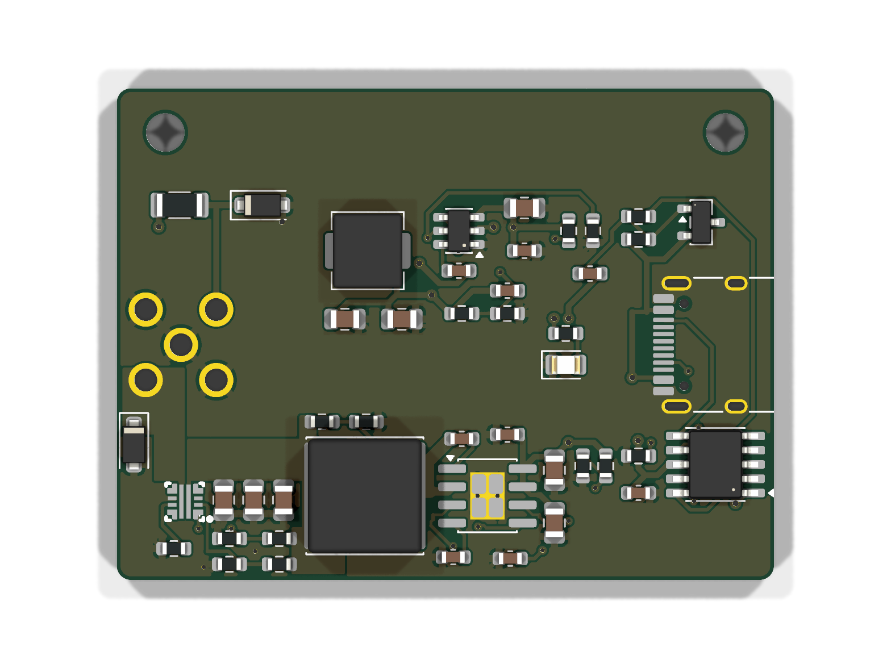

# C128 USB-C PD Power Adapter (v0.1)

The Commodore 128 variant of the C64 adapter. It plugs straight into the C128's square 5-pin power socket and runs from a USB-C PD charger offering 15 V (45 W or more).

**Status: v0.1, routed, JLCPCB files generated, not yet built or tested.**



## What it does
| Output | DIN pin | Source |
|---|---|---|
| ~5.0 V, ~3 A | 1 | SY8205 5 A buck (U2) → TPS259470A eFuse (U4) |
| +12.3 V DC | 3 (one leg of the C128's "9 VAC" input) | TPS54302 buck (U3) |
| GND | 2, 4, 5 (5 = the other 9 VAC leg) | |

It shares its input side with the C64 board:
- **PD sink:** a CH224A requests 15 V.
- **Output switch:** a P-MOSFET (Q1) connects the 15 V only once the PD contract is made.
- **Lockout:** both bucks have an EN-pin UVLO that starts at about 13.3 V.

## Power connector (J2)
- **Socket grid:** the C128 socket (the same square shell the Amiga 500 uses) puts its 5 contacts on the **round 8-pin DIN grid**: the centre pin plus the 4 diagonal pins of the 7.0 mm circle.
- **J2 is a round 8-pin DIN male insert** (7 around plus a centre pin) with the 3 unused pins pulled. It is soldered through the board from the top side, like the C64 version.
- **Pinout:** taken from the Drunk'n'Retro C128-to-C64 adapter diagram. Looking at the plug face, key up:
  ```
    3 (+12V)    2 (GND)
          5 (GND)
    4 (GND)     1 (+5V)
  ```
- **Position:** the DIN centre is 4.5 mm from the board's right edge, so the board stays clear of the C128's power switch.
- **Keying warning:** a round insert has **no key in the square socket**. Rotated 90°, it would put 12 V on the C128's +5 V rail. Use a keyed shroud or case, and mark the top. No case is provided yet.

## Protection
| Protection | How |
|---|---|
| Nothing powers up without a 15 V USB-PD contract | CH224A PG gates Q1 |
| Bucks stay off below ~13.3 V | EN-pin UVLO on U2 and U3 |
| **+5 V over-voltage cutoff** | U4 TPS259470A eFuse disconnects DIN pin 1 if the buck output rises above **5.64 V** (releases at 5.13 V). It survives up to 23 V at its input, so a shorted buck (15 V) is cut off. |
| **+5 V current limit / short circuit** | U4 limits at **4.45 A** (R17 = 750 Ω) with auto-retry, and blocks reverse current |
| Buck current limit and thermal shutdown | U2, U3 |
| Spike clamps | SMF5.0A TVS on +5 V, SMF13A on +12 V |

The eFuse drops about 0.1 V at 3 A, so the C128 sees about 5.0 V.

**The 3 A path:**
- **Inductor to eFuse:** the inductor output reaches the eFuse through a solid ~57 mm² B.Cu copper area.
- **eFuse to DIN pin 1:** a ~28 mm² area.
- **Layout:** both areas are reserved as no-track zones before autorouting (`scripts/power_planes.py`).

## Before the first power-up
Leave the adapter **unplugged from the C128**. Pin 1 should read about 5.0 V, pin 3 should read 12.3 V, and pins 2/4/5 should read 0 V.

Also check JLC's placement preview for **U2** (SOIC-8-EP) and **U4** (2x2 mm QFN): neither rotation has been confirmed yet.

## Files
- `KiCad/`: KiCad 10 project.
- `scripts/`: the generators and the routing pipeline. `full_c128.sh` runs route, pours, GND stitching and DRC, retrying until the board is fully connected; then run `make_fab.py`. Freerouting 2.5.0 runs through `FREEROUTING_JAR`.
- `JLCPCB Output/`: Gerbers, BOM, CPL and `ORDER NOTES.txt`.
- `Docs/`: schematic PDF and renders.
