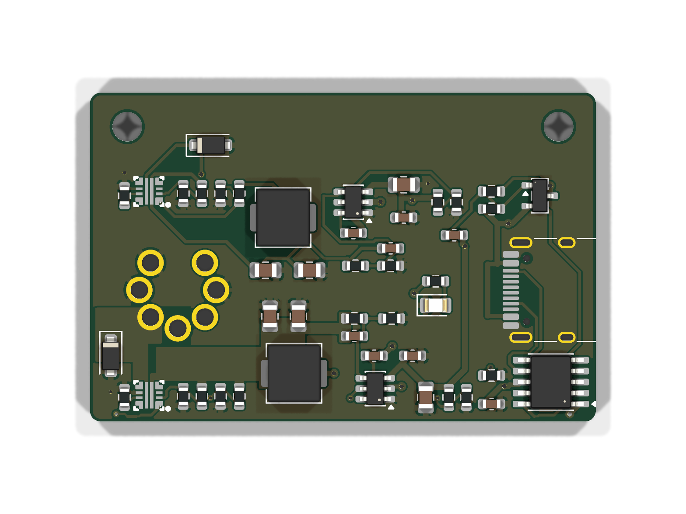

# C64 USB-C PD Power Adapter v0.4: over-voltage protection

The tested v0.3 board with an over-voltage cutoff on both outputs. The board size (46.1 x 30 mm), mounting holes, DIN-7, USB-C and LED positions are unchanged, so the v0.3 case fits.

**Status: designed, routed and DRC-clean. Not yet built.** The tested design is still v0.3 (the main `Hardware/` folder).

## What changed from v0.3
F1/F2 were 0R links (no protection). They are replaced by two TI TPS259470A eFuses (LCSC C3662799):

| Rail | eFuse | Cuts off above | Back on below | Current limit |
|---|---|---|---|---|
| +5 V (DIN 4/5) | U4 | 5.70 V (R15 75k / R16 20k) | 5.18 V | 3.3 A (R17 1k) |
| +12 V (DIN 6) | U5 | 14.2 V (R20 51k / R21 4.7k) | 12.9 V | 1.5 A (R22 2.2k) |

- **Shorted converter:** if a buck fails and passes the full 15 V input through, its eFuse disconnects the C64 within microseconds. The eFuses are rated for 23 V at their input, so they survive that.
- **Short or overload:** current-limited, with automatic retry.
- **Reverse current** (e.g. from a cartridge or user-port device) is blocked.
- **TVS diodes** D1 (5 V) and D2 (12 V) stay, behind the eFuses, for fast transients.
- **Power LED** now shows that the 5 V eFuse is on.
- **Voltage at the C64:** the 5 V eFuse drops ~0.05 V at 1.5 A, so the C64 sees about 5.0 V.

Every new resistor is a JLC Basic part. The eFuse is the only new extended part (one setup fee covers both).

## Layout notes
- The 5 V path is solid copper (no thin tracks): one area from the buck output to U4, one from U4 to DIN pin 5. The eFuse's IN/OUT pads are 0.3 mm bars only 0.19 mm apart, so a wide track can't reach them.
- Freerouting ignores KiCad copper zones as obstacles, so `power_planes_v04.py` adds no-track rule areas over the 5 V copper before routing. It also pre-draws a few locked links (DIN pin 4 to 5 on the top layer, eFuse GND pins to vias).
- The 12 V eFuse nets are 0.3 mm tracks. That is plenty for the C64's "9 VAC" load.
- L1 is turned round compared with v0.3, so its switch-node pad faces U2. The 5 V output caps C6/C7 are turned to sit on the 5 V copper.

## Files
- `KiCad/`: KiCad 10 project.
- `scripts/`: `gen_sch_v04.py` (schematic), `build_v04.py` + `place_v04.json` (placement), `power_planes_v04.py`, `full_v04.sh` (route, pour, stitch, DRC loop). Also `set_netclasses_v04.py`, `pours_v04.py`, `stitch_gnd.py`, `drop_dangling_vias.py`, `make_fab.py`.
- `JLCPCB Output/`: Gerbers zip, BOM, CPL and `ORDER NOTES.txt`.
- `Docs/`: 3D renders, routing plot, schematic PDF.

**Before ordering:** check the rotation of U4 and U5 in JLC's placement preview (see ORDER NOTES).
