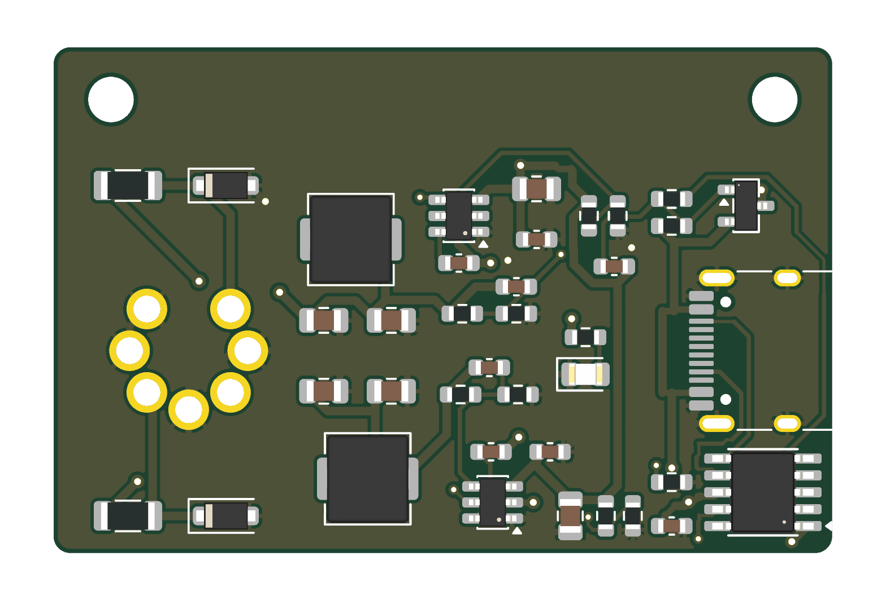

# C64 USB-C PD Power Adapter

A compact replacement power supply for the Commodore 64. It plugs straight into the C64's 7-pin DIN power socket and runs from any USB-C Power Delivery charger that offers 15 V.

**Status: v0.3, routed, JLCPCB files generated, not yet built or tested.**

**v0.3 (cost-down):**
- All passives are 0603 JLC Basic parts.
- The TVS diodes are JLC Preferred parts.
- Both bucks share one inductor (FXL0530).
- The PTC fuses became 0R links. The 1206 footprints still take a PTC if you want one.
- 5 V feedback is now 75k/10k (5.07 V).
- Extended parts went from 15 to 4: CH224A, TPS54302, USB-C, inductor.

## What it does
| Output | DIN pin | Source |
|---|---|---|
| +5.07 V, up to 3 A | 4, 5 | TPS54302 buck (U2) |
| +12.3 V DC, ~1 A | 6 (the C64's "9 VAC" input) | TPS54302 buck (U3) |
| GND | 1, 2, 3, 7 | |

- **PD sink:** a WCH CH224A requests 15 V from the charger (R1 = 56k).
- **Output switch:** a P-MOSFET (Q1) connects the 15 V rail only once the PD contract is made (PG low). Its Miller cap gives a soft ~10 ms ramp.
- **Lockout:** both bucks have an EN-pin UVLO that starts at ~13.2 V. A plain 5 V charger, or one that falls back to 9/12 V, never powers the C64.
- **Protection:** each output has a TVS diode. F1/F2 are 0R links by default; fit 1206 PTCs there if wanted.

### Why 12 V DC on pin 6
The C64 runs its "9 VAC" input through its own bridge rectifier and a 7812 (breadbin) or 7809 (C64C).

- **Stock supply:** 9 VAC peaks at about 12.7 V.
- **12 V DC** matches that peak, so neither the C64 nor any user-port device (pins 10/11) sees more than an original PSU gives.
- **9 V DC** would starve a breadbin's 6581 SID (12 V supply) and drop out a C64C's 7809.
- **To get 9 V anyway:** change R12 to 7.15k (8.9 V).

**Limitations:** the supply is DC only, so the CIA time-of-day clock won't tick, and user-port devices that need real AC won't work. Same as other DC C64 supplies.

## Hardware
- **Board:** 46.1 x 30 mm, 2-layer, GND pours both sides.
- **J2:** a 7-pin DIN (DIN 45329) male plug insert, soldered through the board from the top side.
  - Pins sit on a 7.0 mm circle at 45° spacing, notch at the top.
  - Holes are 1.6 mm with 2.4 mm pads.
  - It is the only hand-soldered part.
- **Assembly:** every SMD part is on the bottom, for single-side JLCPCB assembly.
- **Case:** 2x M2.5 mounting holes are provided for a future case.
- **USB-C:** HRO TYPE-C-31-M-12. Only VBUS/GND/CC are connected; D+/D- are left open, because PD needs only CC.

## Repository
- `Hardware/KiCad/`: KiCad 10 project (schematic, routed PCB, project libraries).
- `Hardware/scripts/`: the generators and routing pipeline:
  - `gen_sch.py`: schematic.
  - `build_v03.py`: board build from the saved placement (`place_v02.json` + `overrides_v03.json`).
  - `add_holes.py`: mounting holes.
  - `set_netclasses.py`, then `autoroute_v02.sh` (Freerouting 2.5.0), then `gnd_pours.py`, then `texts_upright.py`.
  - `make_din_fp.py`: DIN-7 footprint.
  - `make_fab.py`: JLC outputs.
  - The generators rebuild from scratch; don't re-run them over hand edits.
- `JLCPCB Output/`: Gerbers zip, BOM, CPL and `ORDER NOTES.txt`.
  - Bottom-side rotation fixes (U1-U3 +90, D1-D3 +180) are already applied. Give the preview a quick check anyway.

## To test on first build
- What the CH224A does with a charger that doesn't offer 15 V (fallback level, PG behaviour).
- Inrush through Q1 into the C64's bulk capacitors.
- The DIN insert's pin diameter against the 1.6 mm holes.
- Desk/power-switch clearance on breadbin and C64C machines.

## Licence
[CC BY-NC-SA 4.0](LICENSE). Non-commercial use only; share derivatives under the same licence.

This is an independent design. The commercial Sordan/RetroJoy adapter and Side Projects Lab's PD-64 (CC BY-NC-ND) were looked at for ideas only. No files or circuitry were copied from either.
